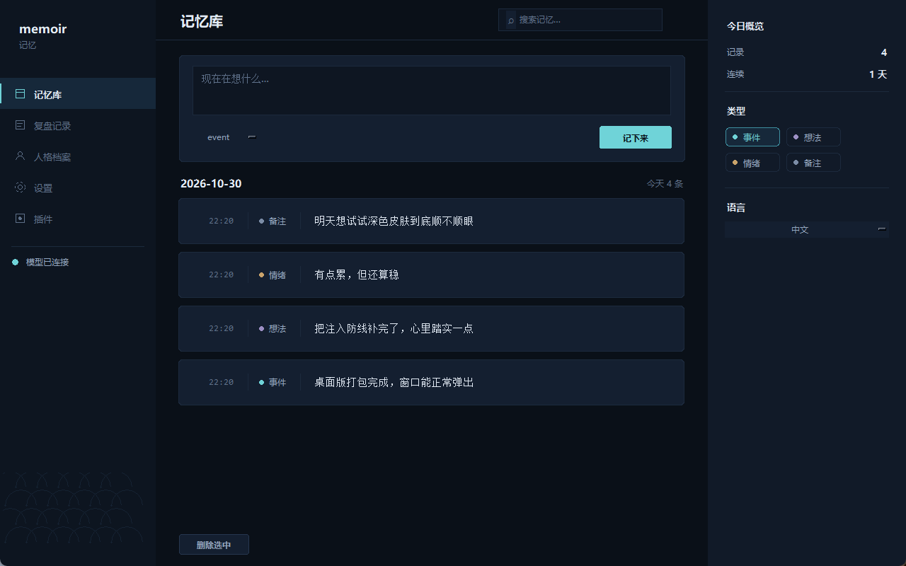
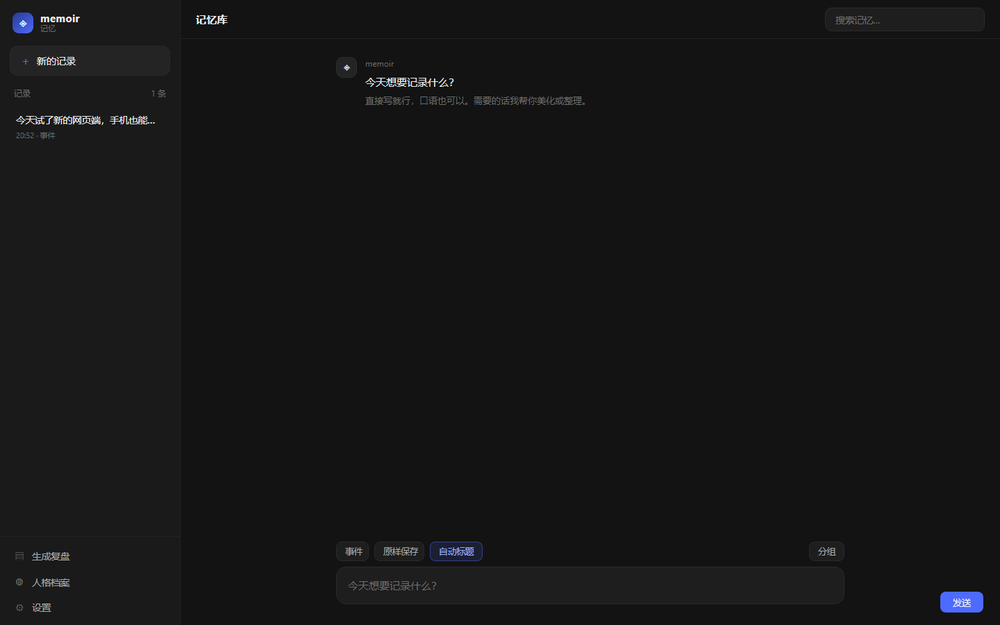

# memoir · 记忆

> 白天记下来，夜里还给你。一个跑在你自己电脑上的个人 AI 记忆系统——桌面、网页、手机都能用，数据一个文件带走。

`memoir` 记录你每天做的事、想的事、心情的起伏；每天晚上把这些流水账还原成一份**你认得出来的**复盘；日子久了，攒出一份关于"你是个什么样的人"的档案。

不是笔记软件，不是聊天机器人，不是某个平台的插件。**一个独立的 Python 程序**，数据全在一个 SQLite 文件里，模型接本地跑的也行。

**当前版本 0.9.0。** 这一版把记忆从"一条条流水"变成了"能走进去的空间"：文件夹可以无限嵌套、条目能改、每天的记忆可以摊成一张星图，复盘也有了自己的一栏。外部的 AI 也能往里面写——比如一个每天定时写日记的脚本。

---

## 1. 项目解决什么问题

记忆工具都能记，但很少能被**读**。三个具体的毛病：

**记了不看。** 一天记十几条，全躺在数据库里，一条条都对，但没人会回头翻。一周后问"上周到底推进了什么"，答不上来。

**同一个坑反复掉。** 每次卡住都记了一笔，但没人把"又卡在这"的五次串起来看。单条记录看不出模式，攒够了也没人提炼。

**翻旧账只能靠印象。** "上次那个端口冲突怎么解决的"——记录就在本地，但检索靠猜关键词，猜不中就找不到。

`memoir` 补的就是这一段：**从记录里提炼结论，把结论写回记录，再让你能按线索找回来。**

边界也说清楚：

- ✅ 记事情、记情绪、每晚复盘、长期画像、本地存储、换模型、插件扩展、四语言
- ❌ 不做待办/日程/云同步，不上传任何数据，不需要账号（网页界面、手机访问都是本地起的）

---

## 2. 主要功能

| # | 能力 | 具体实现 |
|---|---|---|
| 1 | **随手记录** | `memoir add` 或桌面/网页输入框，分四种类型（事件/想法/情绪/备注），可带标签、情绪分 |
| 2 | **每晚复盘** | 读当天全部记录，产出五段：做了什么事 / 心里话与情绪 / 想法与思维变化 / 性格与状态 / 给你的话 |
| 3 | **人格档案** | 每次复盘后蒸馏"有证据的观察"，带置信度和出处；累积成画像 |
| 4 | **记事本模式** | 记忆写成每天一个 `.md`，直接拿记事本改；`memoir notes --sync` 把改动合并回库（新增/更新/删除都认） |
| 5 | **网页端 + 手机** | `memoir web` 起本地服务，手机连同一 WiFi 直接访问；壁纸引擎联动、文笔美化、语法高亮都在这边 |
| 6 | **账号与个人主页** | 可选。邮箱+密码注册，个人主页显示昵称、简介和四项统计；不登录照常使用 |
| 7 | **多模型接入** | 任何 OpenAI 兼容的 `/v1/chat/completions`：Ollama、vLLM、LM Studio、DeepSeek、Qwen…改三个环境变量就换 |
| 8 | **插件扩展** | `~/.memoir/plugins/*.py` 丢进去即生效，三个钩子，异常隔离不拖垮主程序 |
| 9 | **多国语言** | 简体中文 / English / 日本語 / 한국어；界面文案和提示词同在一个语言包里 |
| 10 | **完全本地** | 一个 SQLite 文件装下全部记忆，无服务器、无遥测；邮箱账号只是可选的本地标识，不上传任何数据 |
| 11 | **无限层级文件夹** | 侧栏是一棵可嵌套的树，拖进去就归位；每个文件夹带条数，折叠状态记在心里 |
| 12 | **记忆银河** | 把一段时间里的记录摊成星图：点一个亮点就跳到那条记录；页面切走自动停渲染，不吃显存 |
| 13 | **条目可编辑** | 写错了不用删了重记，点开就能改，改完立刻进全文索引 |
| 14 | **复盘独立成栏** | 每天的复盘单独一个文件夹，不跟当天的流水混在一起 |
| 15 | **外部写入接口** | 任何脚本/Agent 都能通过本地 HTTP 接口写一条、挪文件夹、改作者——日志类工具接进来不用碰数据库 |
| 16 | **批量导入导出** | `memoir export` 打包全库；记事本文件改完 `--sync` 合并，冲突按时间戳判定 |

### 没有模型也能用

模型挂了程序不崩。复盘降级成本地统计摘要，标注 `model=fallback`；并且**降级内容不会写进人格档案**——宁可少一条观察，也不往档案里塞模板话术。

---

## 3. 安装方法

需要 **Python 3.10+**。没有第三方依赖。

```bash
git clone <你的仓库地址> memoir
cd memoir
pip install -e .
```

不装也能用，直接在仓库目录里跑：

```bash
python -m memoir --help
```

### 验证

```bash
memoir --version        # memoir 0.9.0
memoir config           # 打印当前配置和数据目录
```

首次运行会自动创建 `~/.memoir/`（数据库、插件目录、日志都在里面）。

### 接上模型（可选但强烈建议）

```bash
# 本地 Ollama
export MEMOIR_BASE_URL=http://127.0.0.1:11434/v1
export MEMOIR_MODEL=qwen2.5:7b

memoir model            # 探活，成功会打印模型回的第一句话
```

Windows PowerShell 用 `$env:MEMOIR_BASE_URL = "..."`。想让配置长期生效，写进 `~/.memoir/config.json`——`memoir config --edit` 会把当前生效的配置原样落盘，再改那个文件即可。

### 可选：每日自动复盘

```bash
# Linux / macOS：cron，每天 23:30
30 23 * * * cd /path/to/memoir && /usr/bin/python3 -m memoir once
```

```powershell
# Windows：任务计划程序
schtasks /create /tn "memoir" /sc daily /st 23:30 /tr "python -m memoir once"
```

想让它一直挂着也行：`memoir daemon`（读 `MEMOIR_REVIEW_AT`，默认 23:30）。

---

## 4. 使用方法

### 日常怎么用

| 场景 | 命令 |
|---|---|
| 随手记一件事 | `memoir add "上午把注册方式改了" --kind event --tags 编程` |
| 记一句心里话 | `memoir add "有点怀疑自己适不适合干这个" --kind thought` |
| 记心情并打分 | `memoir add "跟家里通了电话，好点了" --kind feeling --mood 1` |
| 管道喂进去 | `echo "今天很顺" \| memoir add -` |
| 看今天记了啥 | `memoir today` |
| 看某一天 | `memoir today --date 2026-10-29` |
| 生成复盘 | `memoir review` |
| 不连模型跑一次 | `memoir review --offline` |
| 看人格档案 | `memoir persona` |
| 手动蒸馏一次 | `memoir persona --distill` |
| 搜以前的记录 | `memoir search 端口冲突` |
| 看统计 | `memoir stats` |
| 导出全部 | `memoir export -o backup.json` |
| 看插件状态 | `memoir plugins` |
| 换语言 | `memoir lang ja` / `memoir --lang ko today` |
| 跑一次夜间任务 | `memoir once` |
| 常驻定时 | `memoir daemon` |

### 建议的节奏

1. **白天随手记**，别攒到晚上补——补出来的东西没有细节。
2. **睡前跑一次** `memoir review`（或让定时任务跑），当天上下文还在，提炼得准。
3. **每周看一眼** `memoir persona`，观察是不是在重复同一个模式。
4. **偶尔搜**：`memoir search <关键词>`，中文可以直接搜。

### 参数说明

`memoir add` 的四个字段：

| 参数 | 取值 | 说明 |
|---|---|---|
| `--kind` | `event` `thought` `feeling` `note` | 不填默认 `event` |
| `--tags` | 任意字符串 | 检索用 |
| `--mood` | `-2`~`2` | 情绪分，不填表示没打 |
| `--source` | 任意字符串 | 标记来源，默认 `cli`，插件/脚本可自定义 |

`memoir review` 的开关：

| 参数 | 作用 |
|---|---|
| `--date YYYY-MM-DD` | 补跑某一天 |
| `--offline` | 跳过模型，用本地摘要 |
| `--no-write` | 只打印，不落库 |
| `--force` | 强制重跑 |

### 桌面界面



> 深色主题的实际运行截图，按 [设计规范](docs/05-ui-design.md) 实现。所有卡片、按钮、导航项都是 Canvas 自绘的圆角——tkinter 原生控件没有圆角。

两种开法：

```bash
memoir gui
```

或者双击 `dist/memoir.exe`（12 MB 单文件，不需要装 Python）。

左侧导航五项：

| 导航 | 干什么 |
|---|---|
| 记忆库 | 输入框 + `Ctrl+Enter` 记一条；下方是记录列表，选中可删 |
| 复盘记录 | 选日期、勾「不连模型」、点生成 |
| 人格档案 | 从最近复盘学习，或刷新看画像 |
| 设置 | 模型地址 / 名称 / API Key / 采样参数，可测连接 |
| 插件 | 已加载插件列表与状态 |

右侧 280px 参数栏随页面更新：今日概览、类型筛选、语言切换。

### 网页版（手机也能用）



```bash
memoir web
```

终端会打印两个地址：本机 `http://127.0.0.1:8765`，以及手机可用的 `http://<局域网IP>:8765`。

浏览器端和桌面端共用同一个 `memoir.db`——桌面记的，手机立刻能看到。

网页版多出来的能力：**壁纸引擎联动**、**文笔美化 / AI 整理**两种保存模式、手机响应式布局。
完整说明见 [07-web](docs/07-web.md)。

**自己打包：**

```bash
pip install pyinstaller
python -m PyInstaller --onefile --windowed --name memoir \
  --add-data "memoir/locales;memoir/locales" --paths . launcher.py
```

产物在 `dist/memoir.exe`。`--onefile` 的代价是启动时先解压，等两三秒是正常的。

---

### 账号与个人主页

可选的一层。设置抽屉最上面是「账号」，填邮箱 + 密码就能注册或登录。

登录后点「个人主页」，能看到：

| 显示项 | 内容 |
|---|---|
| 头像 | 昵称首字 |
| 昵称 / 简介 | 可编辑，保存即时生效 |
| 四项统计 | 记录数 · 天数 · 复盘数 · 人格条目数 |

**不登录照样能用**——账号只影响个人主页这一块，记录、复盘、人格都不依赖它。

**邮箱不发验证邮件。** 本地单机应用没有 SMTP 服务，邮箱在这里只是账号标识，不证明归属。
真要验证码得配一个 SMTP 账号（QQ 邮箱 / 163 都行）。

**为什么不接 QQ / 微信登录**：QQ 互联和微信开放平台都要求企业主体 + 备案网站，个人开发者办不下来。
硬做只能放几个假按钮，点了还是走本地账号。

---

## 5. 输入输出示例

以下均为实际运行结果，未做文字加工。

### 5.1 记录 → 回看

输入：

```console
$ memoir add "上午改了插件的注册方式，还是没生效，有点烦" --kind event --tags 编程
已记下 #1（event）

$ memoir add "其实我有点怀疑自己是不是不适合折腾这些，但又不甘心" --kind thought
已记下 #2（thought）

$ memoir add "晚上跟家里通了电话，心情好了一点" --kind feeling --mood 1
已记下 #3（feeling）
```

输出：

```console
$ memoir today
2026-10-30 的记录（3 条）
-------------------
[20:51] #1 (event) 上午改了插件的注册方式，还是没生效，有点烦 #编程
[20:51] #2 (thought) 其实我有点怀疑自己是不是不适合折腾这些，但又不甘心
[20:51] #3 (feeling) 晚上跟家里通了电话，心情好了一点 mood=+1
```

> `#数字` 是条目 id，`mood=+1` 是你打的分。

### 5.2 复盘（接了模型）

输入：`memoir review`

输出：

```console
2026-10-30 · 今日复盘
=================

【今天做了什么】
上午修改了插件的注册方式，但未生效，感到烦躁。晚上与家人通话后，心情有所改善。

【心里话与情绪】
我开始怀疑自己是否适合做这些技术上的事情，但内心又不愿放弃。和家里人通话后，感觉好多了。

【想法与思维变化】
在面对问题时，既有自我怀疑，又不甘心继续尝试。通过与家人沟通，情绪得到了缓解。

【性格与状态】
表现出一定的挫败感和自我质疑，但在与家人交流后展现出情绪调节能力。

【给你的话】
你似乎在技术上遇到了挫折，但和家人通话后心情好多了，这种情绪的起伏很真实。

—— 依据 3 条记录 · 模型 qwen3-8b-zh-fast:latest · 语言 zh
```

> 这是本机 Ollama 8B 模型的真实输出，一个字没改。换 14B 或线上模型，五段会写得更细。

### 5.3 复盘（不接模型）

输入：`memoir review --offline`

输出：

```console
2026-10-30 · 今日复盘
=================

【今天做了什么】
上午改了插件的注册方式，还是没生效，有点烦; 晚上跟家里通了电话，心情好了一点

【心里话与情绪】
其实我有点怀疑自己是不是不适合折腾这些，但又不甘心

【想法与思维变化】
今天记录的分布：event×2, thought×1。本地模式只能给出统计，接上模型后这里会是具体的思维观察。

【性格与状态】
本地模式暂不做性格推断，接上模型后由 AI 结合长期档案给出。

【给你的话】
今天记了 3 条，从 20:51 到 20:51。能坚持记下来，本身就说明你在认真对待自己的日子。

—— 依据 3 条记录 · 模型 fallback · 语言 zh
```

> `model fallback` 就是明确告诉你：这段是兜底，不是 AI 写的。

### 5.4 人格档案

输入：`memoir persona --distill`

输出：

```console
本次学到 5 条人格观察

我眼里的你
=====

## 情感模式
- 在遇到技术难题时容易产生挫败感和自我怀疑 · 置信度 0.60（2026-10-30 上午修改了插件的注册方式，但未生效，感到烦躁）

## 对待挫折的态度
- 不愿轻易放弃，但会因遇到困难而产生自我质疑 · 置信度 0.60（2026-10-30「我开始怀疑自己是否适合做这些技术上的事情，但内心又不愿放弃」）

## 人际关系倾向
- 在压力下倾向于寻求家人支持以获得情绪安慰 · 置信度 0.60（2026-10-30 晚上与家人通话后，心情有所改善）

累计 3 条记录 / 1 天 / 1 份复盘
```

> 每条观察都挂着它的出处。说不清来源的观察不会进档案。

### 5.5 检索

输入：`memoir search 插件`

输出：

```console
与「插件」相关的记录（1 条）
---------------
[20:51] #1 (event) 上午改了插件的注册方式，还是没生效，有点烦 #编程
```

---

## 数据与隐私

| 问题 | 答案 |
|---|---|
| 存在哪 | `~/.memoir/`：`memoir.db`（记忆）、`config.json`、`memoir.log`、`plugins/` |
| 会上传吗 | 不会。除了你配的模型接口，程序不发起任何网络请求 |
| 有账号吗 | 没有 |
| 有遥测吗 | 没有 |
| 能带走吗 | `memoir export` 输出全量 JSON |
| 能删干净吗 | 删掉 `~/.memoir/` 即可 |

用线上模型时，发给模型的是当天的记录原文。这是用线上模型的固有代价，不是 memoir 额外干的。**最私密的用法是本地模型。**

## 命令一览

| 命令 | 作用 |
|---|---|
| `add` | 记一条（`--kind` `--tags` `--mood` `--source`） |
| `today [--date]` | 看某天的记录 |
| `review [--date] [--offline] [--no-write] [--allow-suspicious]` | 生成复盘（`--no-write` 只预览不落库；`--allow-suspicious` 强制纳入疑似指令的记录） |
| `persona [--distill] [--days N]` | 看/更新人格档案 |
| `search <query> [-n N]` | 全文检索 |
| `stats` | 统计 |
| `export [-o file]` | 导出 JSON |
| `plugins` | 插件列表与加载状态 |
| `model` | 探活模型 |
| `config [--edit]` | 查看配置 |
| `lang <zh\|en\|ja\|ko>` | 切语言 |
| `once [--date]` | 跑一次夜间任务 |
| `daemon` | 常驻定时 |

全局参数：`--lang`（临时切语言）、`--home`（换数据目录）、`--version`。

## 环境变量

| 变量 | 默认 | 说明 |
|---|---|---|
| `MEMOIR_HOME` | `~/.memoir` | 数据目录 |
| `MEMOIR_LANG` | `zh` | 界面语言 |
| `MEMOIR_BASE_URL` | `http://127.0.0.1:11434/v1` | 模型接口 |
| `MEMOIR_MODEL` | `qwen2.5:7b` | 模型名 |
| `MEMOIR_API_KEY` | 空 | 本地模型留空 |
| `MEMOIR_TEMPERATURE` | `0.7` | 采样温度 |
| `MEMOIR_MAX_TOKENS` | `2048` | 单次上限 |
| `MEMOIR_TIMEOUT` | `120` | 超时秒数 |
| `MEMOIR_REVIEW_AT` | `23:30` | 守护进程触发时间 |

环境变量 > `config.json` > 默认值。

## 项目结构

```
memoir/
├── memoir/
│   ├── config.py       配置加载
│   ├── i18n.py         多语言与回退
│   ├── storage.py      SQLite + FTS5
│   ├── llm.py          OpenAI 兼容客户端（零依赖）
│   ├── prompts.py      提示词组装
│   ├── review.py       复盘引擎
│   ├── persona.py      人格档案
│   ├── plugins.py      插件加载与钩子
│   ├── scheduler.py    夜间调度
│   ├── cli.py          命令行
│   └── locales/        zh / en / ja / ko
├── plugins/example_mood.py
├── docs/               架构 / 插件 / 模型 / 多语言 / UI 规范 / 全生命周期
├── tests/test_smoke.py 11 个用例
├── pyproject.toml
├── .env.example
└── LICENSE
```

## 常见问题

**复盘写着「模型不可用」**
模型没连上。`memoir model` 看具体原因，检查 `MEMOIR_BASE_URL` 和模型名。

**报 404 model not found**
名字必须和服务里一致。`curl -s $MEMOIR_BASE_URL/models` 查，Ollama 的名字常带 `:latest`。

**复盘像模板、很空**
换大一点的模型，或把 `MEMOIR_TEMPERATURE` 调到 0.7。

**同一天想重跑**
直接再跑 `memoir review`，覆盖当天那份，不会堆重复。

**记录写错了**
`memoir export` 导出后修 JSON 再自行处理。程序故意不提供批量编辑，避免误删记忆。

**中文搜索搜不到**
FTS 用 trigram，1~2 个字会退回 LIKE 匹配；词越长越准。

**换电脑**
整个 `~/.memoir/` 拷走即可；只要数据就拷 `memoir.db`。

## 文档

| 文档 | 内容 |
|---|---|
| [01-architecture](docs/01-architecture.md) | 模块划分、数据流、数据库表、降级策略 |
| [02-plugins](docs/02-plugins.md) | 插件三个钩子、ctx 能拿到什么、调试 |
| [03-models](docs/03-models.md) | 各家模型怎么接、参数建议、排错 |
| [04-languages](docs/04-languages.md) | 语言包结构、回退规则、怎么加新语言 |
| [05-ui-design](docs/05-ui-design.md) | 色板、字体、栅格、组件划分、绘图提示词 |
| [06-engineering](docs/06-engineering.md) | **全生命周期**：需求 → UI → 前端 → 后端 → 数据库 → 模型 → 测试 → 部署 → 迭代 |
| [07-web](docs/07-web.md) | Web 端：架构、接口表、壁纸引擎、美化开关、手机访问与排查 |

## 开发

```bash
python tests/test_smoke.py     # 不需要 pytest
python -m pytest tests/ -q     # 装了 pytest 也行
```

16 个测试覆盖：存取、检索、删除、复盘幂等、空日、人格降级不污染、语言包完整性、JSON 截断修复、套娃结构归一化、导出结构、--no-write 不落库、复盘覆盖保留历史、控制字符清洗、插件白名单、注入隔离与污染检测。

## License

[MIT](LICENSE)
