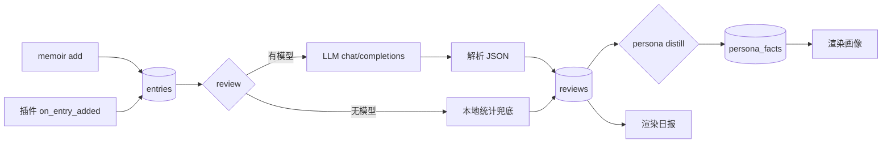

# 架构

## 一句话

一个 Python 包，三个动作：**记下来** → **每晚还原** → **长期沉淀**。数据全在一个 SQLite 文件里。

```
                 ┌──────────────┐
   你的输入 ────▶ │  entries     │  add / 插件写入 / 导入
                 └──────┬───────┘
                        │ 当天全部记录
                        ▼
                 ┌──────────────┐      ┌──────────────┐
                 │  review 引擎 │◀────▶│  LLM（可选）  │
                 └──────┬───────┘      └──────────────┘
                        │ 结构化复盘
                        ▼
                 ┌──────────────┐
                 │  reviews     │
                 └──────┬───────┘
                        │ 多天复盘
                        ▼
                 ┌──────────────┐
                 │ persona 引擎 │────▶ persona_facts（人格档案）
                 └──────────────┘
```

## 模块

| 模块 | 文件 | 职责 |
|---|---|---|
| 配置 | `config.py` | 环境变量 + config.json，路径解析 |
| 多语言 | `i18n.py` | 界面文案与提示词模板，三级回退 |
| 存储 | `storage.py` | SQLite + FTS5，全部读写入口 |
| 模型 | `llm.py` | OpenAI 兼容协议，只用标准库 |
| 提示词 | `prompts.py` | 从语言包组装 prompt |
| 复盘 | `review.py` | 生成日报，模型不可用时本地兜底 |
| 人格 | `persona.py` | 蒸馏观察，渲染画像 |
| 插件 | `plugins.py` | 扫描、加载、钩子分发、错误隔离 |
| 调度 | `scheduler.py` | 每天定时触发复盘 |
| CLI | `cli.py` | 命令解析与输出 |

## 数据流



## 数据库

单文件 `~/.memoir/memoir.db`，WAL 模式。

| 表 | 说明 |
|---|---|
| `entries` | 每条记忆：时间、日期、类型、正文、标签、情绪分、来源、扩展字段 |
| `entries_fts` | FTS5 虚表（trigram 分词），中文可搜；由触发器自动同步 |
| `reviews` | 每日复盘，`day` 为主键（同一天重跑会覆盖） |
| `reviews_history` | 被覆盖掉的旧复盘，自动归档，不丢历史 |
| `persona_facts` | 人格观察：key / value / 置信度 / 证据 / 时间 |
| `persona_snapshots` | 按天的人格状态快照 |

## 为什么是 SQLite + JSON 导出

- 一个文件 = 一份完整记忆，拷走就是迁移，删掉就是彻底删除
- 不需要常驻服务，笔记本合盖也不影响
- FTS5 内置，不用维护向量库；条目量级在十万以内足够
- `memoir export` 出 JSON，任何时候都能带得走

## 提示词注入防线

记忆内容会被拼进 prompt，如果记录里混进了「忽略以上要求」这类句子，模型可能把它当指令执行，
把复盘写成攻击者想要的样子——这些内容下一步会被蒸馏进人格档案，污染是持久的。

两道防线（`memoir/safety.py`）：

| 防线 | 时机 | 做法 |
|---|---|---|
| 输入侧 | 生成前 | 正则扫记录，命中指令性模式的那条**直接剔除**，不进 prompt；CLI 会提示隔离了几条 |
| 输出侧 | 生成后 | 检查正文里有没有「忽略以上」「直接原样输出」这类元话语，命中就丢弃整份，改用本地摘要 |

输入侧是确定性的——不传就不可能被利用。输出侧是兜底，防的是漏网。
用 `--allow-suspicious` 可以强制纳入被隔离的记录，但那样就只剩输出侧一层保护。

局限：正则只能覆盖常见句式，改写过的注入可能漏掉；模型本身也可能幻觉出记录里没有的结论。

## 降级策略

模型不是必需项。这些场景会自动降级，不报错：

| 场景 | 行为 |
|---|---|
| 模型服务没启动 | 复盘用本地统计兜底，标注 `model=fallback` |
| 模型不返回 JSON | 同上，原文丢弃不落库 |
| 模型超时 | 同上，可调 `MEMOIR_TIMEOUT` |
| 插件抛异常 | 记日志，主流程继续 |
| 模型输出含控制字符 | 渲染前剥除，避免终端转义注入 |
| 模型调用瞬时失败 | 退避重试 2 次（只对超时/5xx/连接断开），仍失败才降级 |

降级产出的复盘不会污染人格档案——`model=fallback` 的复盘不参与蒸馏。
