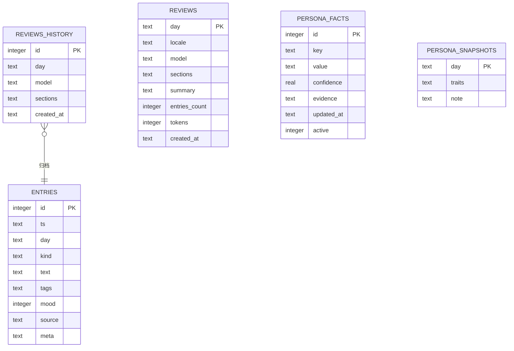

# 全生命周期文档

> 从「要做什么」到「怎么上线、怎么继续改」。每个环节都按本项目真实情况写，
> 不含糊其辞，也不假装有其实没有的东西。

## 0. 先说清楚：这是个什么产品

你列出的九个环节，出自典型的 **Web 产品**流程（前端 / 后端 / 服务器 / 域名 / 权限）。
memoir 是**单机桌面应用**：一个进程、一个 SQLite 文件、没有服务器也没登录。硬套那套流程会失真。

所以下面每一节都按两种写法给：

- **本项目怎么做** —— 真实情况，可核对代码
- **如果改成 Web 服务** —— 那套流程该怎么落，以及代价是什么

| 环节 | 本项目 | Web 版会变成 |
|---|---|---|
| 需求与产品 | 单人自用，无账号体系 | 多租户，要区分「谁的记忆」 |
| UI/UX | tkinter 自绘，1280×800 固定审美 | 响应式，要兼容各种屏幕与浏览器 |
| 前端 | `memoir/ui/` 桌面层 | React/Vue + 构建链 |
| 后端 | Python 模块，进程内调用 | HTTP API + 服务进程 |
| 数据库 | 单文件 SQLite，本地 | 服务端 PG/MySQL + 备份策略 |
| 模型 | 客户端直连用户自己的模型 | 服务端代理，要考虑密钥托管与限流 |
| 测试 | 16 个 pytest 用例 | 再加端到端、压测、多端兼容 |
| 部署运维 | 打包 exe，用户自己机器 | 服务器、域名、证书、监控、告警 |
| 迭代 | tag + Release，用户手动更新 | 灰度、回滚、灰度发布 |

**为什么不做成 Web**：记忆数据是这个产品最私密的部分。做成服务就意味着数据要离开你的机器，
或者你得自己维护一台服务器。这个代价与「本地私有」的产品前提直接冲突。

---

## 1. 需求和产品设计

### 1.1 给谁用

**单一用户：你自己。** 不是团队、不是开源社区共用实例。

这个前提决定了很多设计：

- 不需要账号、不需要多用户隔离
- 不需要「分享」「协作」「评论」
- 界面不需要考虑陌生人第一次上手（你知道自己在干什么）
- 但反过来，**数据持久性和可迁移性要求极高**——你换了电脑，东西必须带得走

### 1.2 要解决什么

| 痛点 | 现状 | memoir 的做法 |
|---|---|---|
| 记了不看 | 笔记软件堆了几百条，从不回看 | 每晚自动生成五段式复盘 |
| 同坑反复 | 每次卡住都记了，但没人串起来 | 人格蒸馏，从多条记录里抽稳定模式 |
| 翻旧账靠猜 | 检索靠回忆关键词 | FTS5 trigram 中文检索 |
| 隐私顾虑 | 不想把日记交给云 | 全本地，一个 SQLite 文件 |

### 1.3 功能边界（明确不做的）

- ❌ 待办 / 日程 / 提醒（那是另一个产品）
- ❌ 多端同步（会引入账号与冲突合并）
- ❌ 社交分享
- ❌ 富文本 / 图片 / 附件（保持纯文本，为了检索与迁移）
- ❌ Web 界面

**做与不做的判断标准只有一条：这件事会不会让「读自己的记忆」变难。**
加待办会让它变成日程管理，加多端同步会让你开始纠结冲突——都偏离主线。

### 1.4 验收标准

一个功能算做完，要同时满足：

1. 命令行能用（`memoir xxx`）
2. 桌面端能用（对应按钮）
3. 有测试覆盖核心路径
4. 不破坏已有数据（幂等 / 可回退）
5. 文档同步更新

### 1.5 和同类产品的差异

| | 日记 App | AI 聊天机器人 | memoir |
|---|---|---|---|
| 记录 | ✅ | ✅ | ✅ |
| 主动复盘 | ❌ 要自己写 | ❌ 要自己问 | ✅ 定时生成 |
| 长期画像 | ❌ | ⚠️ 上下文有限 | ✅ 落盘的人格档案 |
| 数据归属 | 云 | 云 | 你自己 |

---

## 2. UI/UX 设计

完整规范见 [05-ui-design.md](05-ui-design.md)，这里只说结构和流程。

### 2.1 信息架构

```
memoir
├── 记忆库      记录 + 列表 + 搜索 + 类型筛选
├── 复盘记录    按日期生成 / 查看五段式复盘
├── 人格档案    长期观察 + 置信度 + 出处
├── 设置        模型参数 / 自定义类型
└── 插件        已加载插件 / 安装示例
```

### 2.2 三条主流程

**流程 A：每天记一条**

```
打开 → 记忆库（默认页）→ 光标在输入框 → 写一句
→ 选类型（下拉）→ Ctrl+Enter 或点「记下来」
→ 列表顶部出现新行（时间/类型/内容三块）
```

关键点：**从打开到记录完成，不超过 3 次操作**。不做「新建文档 → 选模板 → 填表单」那种仪式。

**流程 B：看今天的复盘**

```
复盘记录 → 日期默认今天 → 点「生成复盘」
→ 按钮变灰、状态栏显示「生成复盘…」（后台线程）
→ 正文区出现五段内容
```

失败时：正文区直接显示降级摘要，末尾标注 `model fallback`，不弹错误框打断阅读。

**流程 C：翻旧事**

```
顶栏搜索框 → 输入关键词 → Enter
→ 列表切换为搜索结果，计数变成「搜索「xx」· N 条」
```

### 2.3 状态设计

| 状态 | 表现 |
|---|---|
| 空 | 居中一行说明 + 引导操作（插件页给两个按钮） |
| 加载 | 状态栏文字，按钮置灰，不转圈 |
| 成功 | 列表 / 正文区更新，不弹提示框 |
| 失败 | 错误就地显示（设置页提示行、复盘正文区），不用模态框 |

**为什么不用模态框**：弹窗会打断阅读，而这个产品的核心是「看」。错误信息放在它该出现的位置就好。

---

## 3. 前端开发（桌面 UI 层）

### 3.1 技术选型

| 方案 | 体积 | 依赖 | 圆角/发光 | 结论 |
|---|---|---|---|---|
| Electron | 100 MB+ | Node 运行时 | ✅ | ❌ 太重，且是网页套壳 |
| Qt (PySide6) | 150 MB 依赖 | 需安装 | ✅ | ❌ 为一个小工具装一整套框架 |
| **tkinter** | **0** | **标准库** | **自绘** | ✅ 采用 |

选 tkinter 的代价是**没有圆角、没有透明度**，全部要自己画。

### 3.2 目录与职责

```
memoir/ui/
├── theme.py     色板 / 字体 / 尺寸常量（改皮肤只改这里）
├── widgets.py   自绘控件：圆角卡片、按钮、导航项、胶囊、鱼鳞纹
└── app.py       主窗口、五个页面、事件绑定
```

### 3.3 自绘的四个关键技术

**圆角**：tkinter 没有圆角矩形。用 `create_polygon(..., smooth=True)` 把八个角点连成平滑多边形近似。

**微光**：tk 没有 alpha 通道，设计稿里的半透明发光做不出来。退一步用偏亮的实色（`#16283A`）近似，
效果比设计稿保守，但至少克制。

**列表**：整块 Canvas 渲染。每行自己画三块（时间 / 类型 / 内容）+ 两道 1px 竖线，
滚动用 `scrollregion`，悬浮用 `<Motion>` 重绘，选中断言下标。

**占位文字**：tk 没有 placeholder。手动插入灰色文本 + 绑定 `<FocusIn>/<FocusOut>` 切换颜色与内容，
并用一个 `_placeholder_on` 标志防止把提示词当成真实输入提交。

### 3.4 状态管理

没有框架，靠三个约定：

1. `self._kind_filter` / `self._page` 这类单值状态直接挂在窗口对象上
2. 改变状态后**只调一个刷新函数**（`_refresh_today` / `_render_panel`），避免多处 UI 不同步
3. 后台任务统一走 `_work` 队列，主线程 `after(120)` 轮询消费

### 3.5 踩过的坑

| 坑 | 现象 | 原因 |
|---|---|---|
| `self._w` | `invalid command name "104"` | `_w` 是 tkinter Widget 内部属性（控件路径名），覆盖后所有 `delete()` 都炸 |
| 搜索框被撑开 | 宽度只有 20px | `place` 设了尺寸，但 `pack` 的子控件把容器撑回去了，要 `pack_propagate(False)` |
| 输入框看不见 | 一片空白 | 输入框背景色与卡片同色且无描边，视觉上「消失」了 |

---

## 4. 后端开发（业务逻辑层）

### 4.1 没有网络接口

命令行和桌面端调的是**同一套 Python 函数**：

```
CLI (cli.py)      ─┐
                   ├─→ storage / review / persona / llm
GUI (ui/app.py)   ─┘
```

好处：不存在「前端等接口」的联调成本，也没有协议版本兼容问题。
代价：任何逻辑改动都要同时考虑两个入口（用统一的服务层函数规避）。

### 4.2 模块职责

| 模块 | 职责 | 不负责 |
|---|---|---|
| `storage.py` | SQLite 读写、FTS 同步 | 业务判断 |
| `review.py` | 生成复盘、降级 | 渲染格式 |
| `persona.py` | 蒸馏观察 | 决定何时蒸馏 |
| `llm.py` | HTTP 调用、重试、JSON 容错 | 提示词内容 |
| `prompts.py` | 组装 prompt | 调用模型 |
| `safety.py` | 注入检测 | 修改数据 |
| `scheduler.py` | 定时触发 | 生成逻辑 |

### 4.3 错误处理原则

| 场景 | 策略 |
|---|---|
| 模型不可用 | 降级本地摘要，标注 `model=fallback`，不抛给用户 |
| 模型返回残缺 JSON | 补括号 → 套娃归一化 → 仍失败才降级 |
| 模型瞬时失败 | 退避重试 2 次（只对超时/5xx/连接断开） |
| 复盘被注入污染 | 丢弃，改用本地摘要，提示原因 |
| 插件异常 | 隔离，记日志，主流程继续 |
| 配置非法 | 就地提示，不崩窗口 |

**统一原则：可降级的不报错，不可降级的要说清楚原因和下一步。**

### 4.4 权限模型

没有鉴权——单用户单机，登录没有意义。

数据保护靠三层：

1. 文件权限：`memoir.db` 与 `config.json` 落盘后 `chmod 600`
2. 网络面：除用户配置的模型地址外不发起任何请求
3. 密钥：只存本地配置，不写日志、不在界面回显（`memoir config` 输出打码）

**Web 版才需要的**：用户认证、会话、密钥托管、限流、审计日志——这些在本项目里全部不存在，别假装有。

---

## 5. 数据库设计

### 5.1 选型

**SQLite 单文件**，理由：

- 一个文件就是一份完整记忆，拷走即迁移，删掉即彻底删除
- 不需要常驻服务，笔记本合盖不影响
- FTS5 内建，中文检索不用引外部依赖
- 条目量级在十万以内完全够用

**Web 版才需要**：PostgreSQL + 连接池 + 定时备份 + 主从。本项目不涉及。

### 5.2 实体关系



### 5.3 表结构

**entries** —— 每条记忆

| 字段 | 类型 | 说明 |
|---|---|---|
| `id` | INTEGER PK | 自增 |
| `ts` | TEXT | ISO8601 本地时间，秒精度 |
| `day` | TEXT | `YYYY-MM-DD`，冗余出来为了按天查得快 |
| `kind` | TEXT | event / thought / feeling / note，或自定义类型名 |
| `text` | TEXT | 正文 |
| `tags` | TEXT | 空格或逗号分隔，检索用 |
| `mood` | INTEGER | -2 ~ +2，可空 |
| `source` | TEXT | cli / desktop / 插件自定义 |
| `meta` | TEXT | JSON，插件放扩展字段 |

**entries_fts** —— 全文索引

```sql
CREATE VIRTUAL TABLE entries_fts USING fts5(
    text, tags,
    content='entries',
    content_rowid='id',
    tokenize='trigram'
);
```

用 **trigram** 而不是默认 `unicode61`：后者把一整句中文当一个 token，基本搜不动。
trigram 按三字滑窗建索引，中文子串能命中。代价是查询词少于 3 字时退回 LIKE。

**reviews** —— 每日复盘（一天一份，`day` 为主键）

| 字段 | 说明 |
|---|---|
| `sections` | JSON：events / thoughts / thinking / character / closing |
| `model` | 生成它的模型名，`fallback` 表示本地降级 |
| `tokens` | 该次调用消耗 |

**reviews_history** —— 被覆盖的旧版本

同一天重跑复盘时，旧记录先搬进来再覆盖。**这是「不丢历史」的兜底**——之前没有这张表，
重跑一次旧复盘就永远没了。

**persona_facts** —— 人格观察

| 字段 | 说明 |
|---|---|
| `key` | 维度：性格 / 价值观 / 情感模式 / 软肋 / 执念 / 偏好 / 待人方式 / 成长 |
| `value` | 一句具体观察 |
| `confidence` | 0~1，重复命中同一观察会缓慢累加（上限 0.99） |
| `evidence` | 出处：哪天、哪句话 |
| `active` | 软删除标记，不物理删 |

### 5.4 索引

| 索引 | 用途 |
|---|---|
| `idx_entries_day` | 按天取记录（最高频） |
| `idx_entries_kind` | 类型筛选 |
| `idx_history_day` | 查某天被覆盖的历史 |
| `idx_facts_key` | 按维度聚合人格档案 |

### 5.5 迁移策略

**没有迁移框架**，靠两条约定：

1. 建表全部 `CREATE TABLE IF NOT EXISTS`，老库升级自动补新表
2. 新字段一律可空或带默认值，不回填历史数据

已知局限：**做不了「改字段类型」「拆表」这类破坏性变更**。真遇到只能写一次性迁移脚本，
并通过 `memoir export` 先做全量备份。

### 5.6 容量与备份

| 指标 | 数值 |
|---|---|
| 单条记录 | 约 200 字节 |
| 每天 20 条 | 4 KB/天，约 1.5 MB/年 |
| 十万条 | 约 20 MB，FTS 索引再翻一倍 |

备份三级：

```bash
# L1 随手
cp -r ~/.memoir ~/.memoir.bak.$(date +%Y%m%d)

# L2 每日（保留最近 14 份）
find ~/.memoir.bak.* -mtime +14 -exec rm -rf {} +

# L3 异地（私有仓库，切勿公开）
cd ~/.memoir && git init && git add -A && git commit -m snapshot
```
---

## 6. 模型 / 算法

### 6.1 不是训练，是接入

本项目**不训练模型**。它做三件事：

1. 用用户自己配的模型（本地或线上），走统一的 OpenAI 兼容接口
2. 用**结构化输出**约束模型，让结果可解析
3. 用**容错与校验**兜住模型的不靠谱

「训练/微调」在这里没有位置：单用户的记忆量不足以训练，而一个能跑 7B 的本地模型
已经足够做「读一遍今天的记录并总结」。

### 6.2 两个调用点

| 调用 | 输入 | 输出 | 频率 |
|---|---|---|---|
| 复盘生成 | 当天全部记录 + 人格档案摘要 | 五段 JSON | 每天 1 次 |
| 人格蒸馏 | 最近 7 天复盘 + 现有档案 | 1~5 条观察 JSON | 每天 1 次 |

### 6.3 结构化输出的五层容错

模型（尤其 8B 本地模型）经常不听话。修复链在 @@@llm.py@@@ 与 @@@persona.py@@@：

| 层级 | 处理 | 针对的失败 |
|---|---|---|
| 1 | @@@extract_json@@@ 抠出第一个 JSON 块 | 前后带解释、代码围栏 |
| 2 | @@@_close_unbalanced@@@ 补齐括号与引号 | 写完字段少一个右花括号（实测 8B 常犯） |
| 3 | @@@unwrap_object@@@ 拆掉多余数组 | @@@[{"facts": [...]}]@@@ 这种套娃 |
| 4 | @@@_normalize_items@@@ 归一化 | 三种花式输出压成统一列表 |
| 5 | 全失败则本地摘要 | 保证「永远有一份结果」 |

### 6.4 提示词工程

三层结构：

```
system: 角色 + 规则 + 「只输出 JSON」
user:   <records> ... </records>   ← 数据用标签隔离
        <persona> ... </persona>
        JSON schema 示例
```

**为什么把 schema 写死进 prompt**：比让模型自由发挥再解析稳得多。schema 本身就是格式约定。

### 6.5 注入防护（两道）

记忆内容会进 prompt。如果记录里混进「忽略以上要求」，模型可能当指令执行——而输出下一步
会进人格档案，污染是持久的。

| 防线 | 时机 | 做法 | 强度 |
|---|---|---|---|
| 输入侧 | 生成前 | 正则识别指令性句式，**默认剔除**，不进 prompt | 确定性 |
| 输出侧 | 生成后 | 正文出现「忽略以上」「直接原样输出」等元话语即丢弃 | 兜底 |

@@@--allow-suspicious@@@ 可强制纳入，那时只剩输出侧。

**局限如实说**：正则只能覆盖常见句式，改写过的注入会漏。这不是完整防护，是把攻击成本抬高。

### 6.6 参数建议

| 参数 | 建议 | 理由 |
|---|---|---|
| temperature | 0.6~0.8 | 太低像公文，太高会编 |
| max_tokens | 1024~2048 | 五段式 800 token 足够 |
| timeout | 120~300 | 本地 7B 首次加载慢 |

### 6.7 模型规模与质量

实测对比（同为 qwen3 系列）：

| 模型 | 复盘质量 | 人格观察条数 | 备注 |
|---|---|---|---|
| 8B | 能跑通，偶有幻觉 | 3~5 条 | 需要容错链兜底 |
| 14B | 细节更足 | 5~8 条 | 推荐日常使用 |

---

## 7. 测试

### 7.1 现有 16 个用例

@@@python tests/test_smoke.py@@@（不需要 pytest，也兼容 pytest）

| 用例 | 覆盖 |
|---|---|
| test_add_and_query | 写入、按天查询、FTS 检索 |
| test_delete | 删除幂等 |
| test_review_fallback | 无模型时降级、复盘幂等 |
| test_review_empty_day | 空日返回 None |
| test_review_no_write_does_not_persist | --no-write 真不落库 |
| test_review_overwrite_keeps_history | 覆盖前归档 |
| test_persona_fallback_does_not_learn_garbage | 降级内容不入档案 |
| test_injection_defenses | 注入检测 + 隔离 + 污染判定 |
| test_i18n_all_locales_have_core_keys | 四语言包键齐 |
| test_i18n_fallback | 缺键回退 |
| test_extract_json_dirty_output | 代码围栏 / 前后缀 |
| test_extract_json_truncated | 缺右花括号 |
| test_unwrap_and_normalize | 套娃结构 |
| test_clean_text_strips_control_chars | ANSI 转义剥离 |
| test_plugins_allowlist | 插件白名单 |
| test_export_shape | 导出结构稳定 |

### 7.2 没覆盖的（如实列）

| 缺口 | 影响 | 补法 |
|---|---|---|
| UI 没有自动化测试 | 改布局靠人眼看截图 | 至少加冒烟：启动窗口不报错后退出 |
| 没有压力测试 | 十万条时的检索性能未知 | 批量插 10 万条后测 search 与按天查询 |
| 没有多模型兼容测试 | 换一家服务可能有格式差异 | 用 mock server 覆盖三种响应形态 |
| 没有崩溃恢复测试 | WAL 下断电行为未验证 | 模拟进程 kill 后重开检查一致性 |

### 7.3 发版前手工清单

```
□ 双击 exe 能开，标题显示正确版本号
□ 记一条 → 列表出现，时间/类型/内容三块对齐
□ 点类型胶囊 → 只剩该类记录，再点取消
□ 设置页加自定义类型 → 下拉里出现，重启后还在
□ 插件页 → 安装示例 → 列表出现
□ 复盘页 → 不勾模型 → 生成，内容是本地摘要
□ 设置页 → 测试连接 → 显示可用/不可用
□ 关掉重开 → 数据都在
```
---

## 8. 部署与运维

### 8.1 三种交付形态

| 形态 | 命令 | 适合谁 |
|---|---|---|
| pip 安装 | pip install -e . → memoir | 有 Python 的开发环境 |
| 单文件 exe | 双击 dist/memoir.exe | 只想用的普通用户 |
| 源码运行 | python -m memoir gui | 改代码的人 |

### 8.2 打包流程

```bash
pip install pyinstaller
python -m PyInstaller --onefile --windowed --name memoir \\
  --add-data "memoir/locales;memoir/locales" \\
  --paths . launcher.py
```

| 参数 | 作用 | 不加会怎样 |
|---|---|---|
| --onefile | 单文件 | 输出一整个目录 |
| --windowed | 无控制台黑框 | 启动时弹 cmd 窗口 |
| --add-data | 打包语言包 | 运行时报找不到 locales |
| --paths . | 能找到同目录的包 | 导入失败 |

**已知代价**：--onefile 启动时要解压到临时目录，双击后 2~3 秒才出窗口，不是卡死。

### 8.3 发布流程

```bash
# 1. 改版本号（三处必须一致）
#    pyproject.toml / memoir/__init__.py / README.md
# 2. 测试
python tests/test_smoke.py
# 3. 提交 + 打标签
git add -A && git commit -m "..."
git tag -a v0.x.0 -m "..."
git push origin main && git push origin v0.x.0
# 4. 发布说明
gh release create v0.x.0 --title "..." --notes-file notes.md --latest
```

### 8.4 日志

@@@~/.memoir/memoir.log@@@，只记元信息（日期、模型名、token 数、插件事件），**不记正文**。
这是刻意的：日志泄露正文等于绕过「本地私有」的承诺。

### 8.5 故障排查表（都是真实踩过的）

| 现象 | 原因 | 解法 |
|---|---|---|
| PermissionError 打包失败 | 旧 exe 还在跑，或杀软在扫 | 杀进程，等 5 秒再删 |
| 桌面快捷方式双击没反应 | 指向的 exe 被移动或删除 | 检查 dist/memoir.exe 是否存在 |
| CRYPT_E_NO_REVOCATION_CHECK | Windows schannel 查不到证书吊销列表 | 仓库级 sslBackend=schannel + schannelCheckRevoke=false |
| 中文路径下 openssl 报错 | CA 路径里的中文变成乱码 | 别用 openssl 后端 |
| 窗口标题是旧版本号 | 打包时没带新代码 | 加 --clean 重新打包 |
| 复盘总是 model fallback | 模型没起或名字不对 | memoir model 看具体错误 |

### 8.6 升级与回滚

- **升级**：覆盖 exe 即可，数据库结构靠 IF NOT EXISTS 兼容旧库
- **回滚**：旧版 exe 能读新版库（只要没改字段语义）；真不行就 memoir export 出 JSON 重建

### 8.7 Web 版才需要的（本项目不做）

服务器、域名、TLS 证书、反向代理、进程守护、监控告警、灰度发布、CDN。
这些不是「没写」，是**架构上就不需要**——没有服务端，就没有服务端运维。

---

## 9. 迭代

### 9.1 版本历史

| 版本 | 主要内容 |
|---|---|
| v0.1.0 | 首个可运行版本：记录 / 复盘 / 人格 / 插件 / 四语言 |
| v0.2.0 | 桌面图形界面、注入防线、安全审计修复、调用重试 |
| v0.3.0 | 深色主题 UI（自绘圆角、微光、鱼鳞纹） |
| v0.4.0 | 字号放大、类型筛选可点、自定义类型、插件页可用 |

### 9.2 当前欠账（真实清单）

| 欠账 | 严重度 | 说明 |
|---|---|---|
| 界面语言下拉没接逻辑 | 中 | 控件在，选了不生效；要接 I18N 并重建界面 |
| 插件页不能启用/禁用 | 中 | 只展示；开关要接 plugins_enabled 并重载 |
| 记录不能编辑 | 中 | 记错了只能删了重记 |
| UI 无自动化测试 | 中 | 改布局靠截图肉眼验收 |
| 无压力测试 | 低 | 十万条时的性能未知 |
| 复盘历史无界面入口 | 低 | 表存在，但界面看不了历史版本 |

### 9.3 路线图

**近期（可用性）**

- 编辑已有记录（行内改或弹窗）
- 语言下拉接上真实切换
- 插件启用/禁用开关
- 复盘历史版本查看

**中期（体验）**

- 按周/月的趋势视图（记录密度、情绪曲线）
- 搜索支持类型 + 日期范围组合过滤
- 导出为 Markdown

**远期（能力）**

- 本地向量检索（条目过万后再考虑）
- 复盘模板可自定义
- 移动端只读视图（导出后看，不是同步）

**不做清单**（明确排除）

- 多端实时同步
- 社交 / 分享
- 云端托管版本

---

## 附：一页速查

```
需求      单人自用，解决「记了不看」
UI        左导航 / 主区 / 右栏，深蓝 + 浅青
前端      tkinter + Canvas 自绘（无框架、零依赖）
后端      Python 模块，CLI 与 GUI 共用
数据库    SQLite 单文件，6 张表，FTS5 trigram
模型      OpenAI 兼容接入，不训练；容错链 + 注入双防线
测试      16 个用例 + 发版前手工清单
部署      PyInstaller 单文件 exe；tag + Release
迭代      按「会不会让读记忆变难」做取舍
```
